# Assignment 4 - Forms and Validation

### Name
Dinislam Mirzadiyar

### Group
IT-2503

### Task 0 - Simple Contact Form

Created a simple contact form with Name, Email, Message and Submit button.

Screenshot:

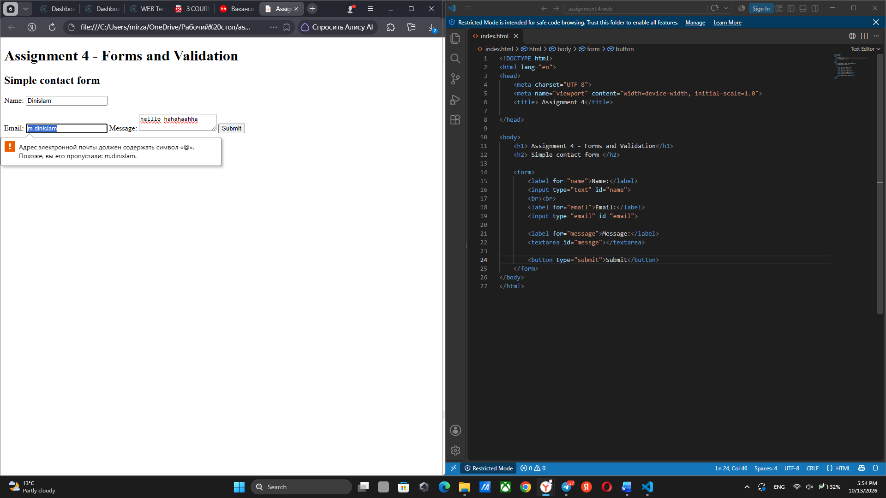

### Task 1 - HTML5 Validation

Added HTML5 validation using required, type and maxlength attributes.

Tested empty fields and invalid email format.

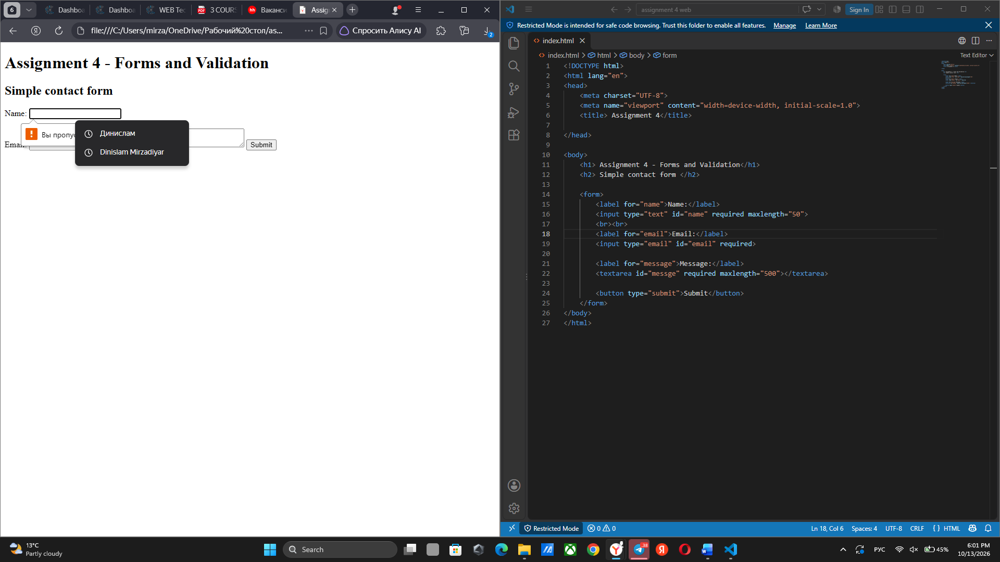

### Task 2 - Bootstrap Form

Added Bootstrap 5.3.3 styles to the contact form.

Used Bootstrap form classes, grid, placeholders and helper text.

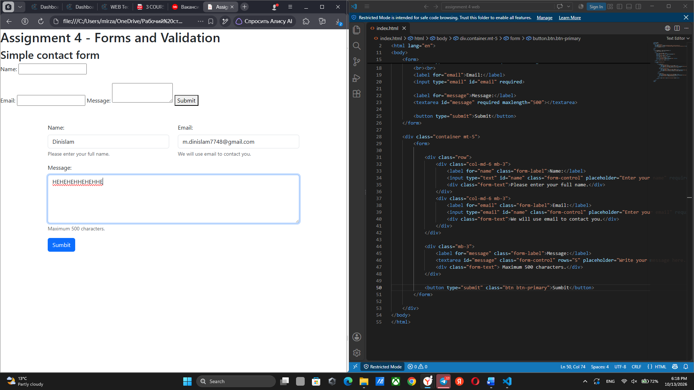

### Task 3 - Bootstrap Validation

Added Bootstrap validation styles using is-valid, is-invalid, valid-feedback and invalid-feedback.

Tested valid and invalid form fields.

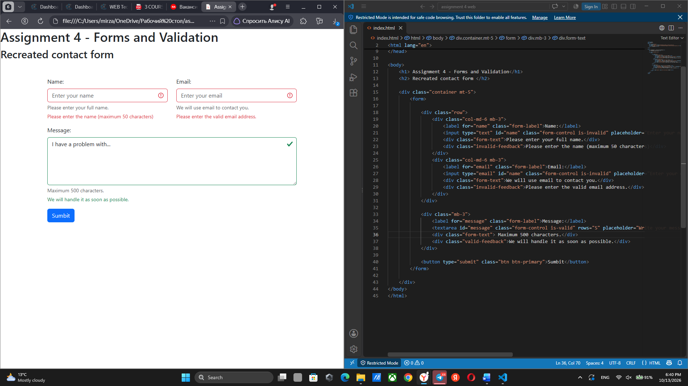
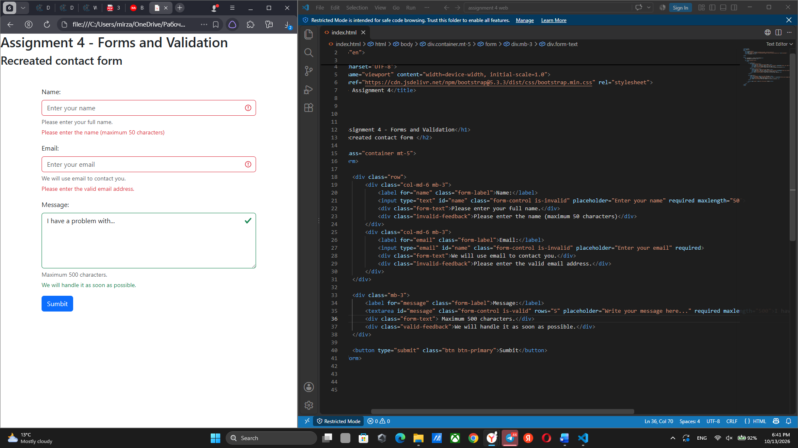

### Task 4 - Registration Form

Created a registration form with First Name, Last Name, Email, Password, Confirm Password, Gender, Hobbies and Country.

Added Submit and Reset buttons.

Used Bootstrap Grid and HTML5 validation.

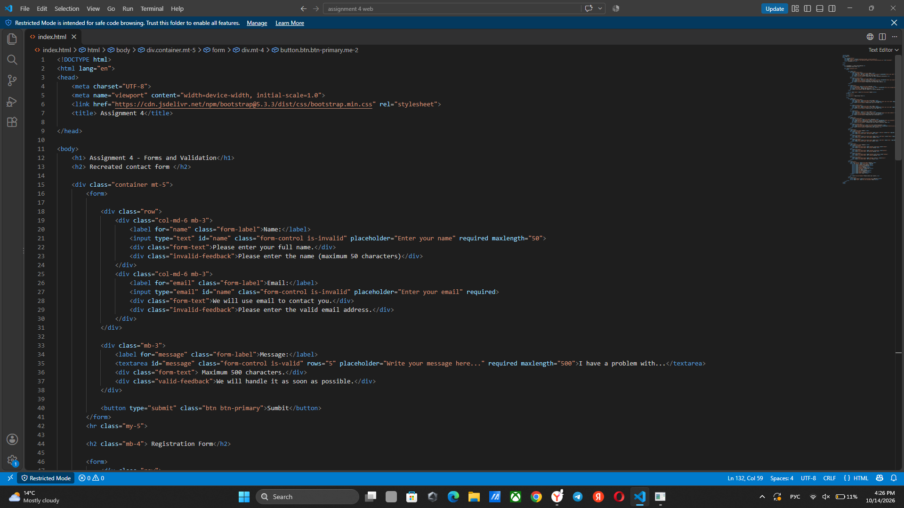
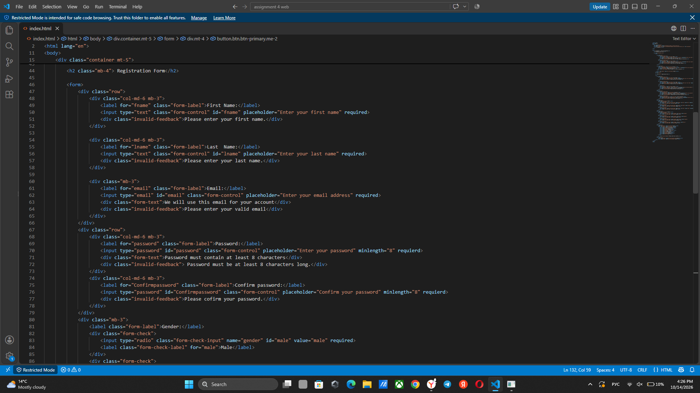
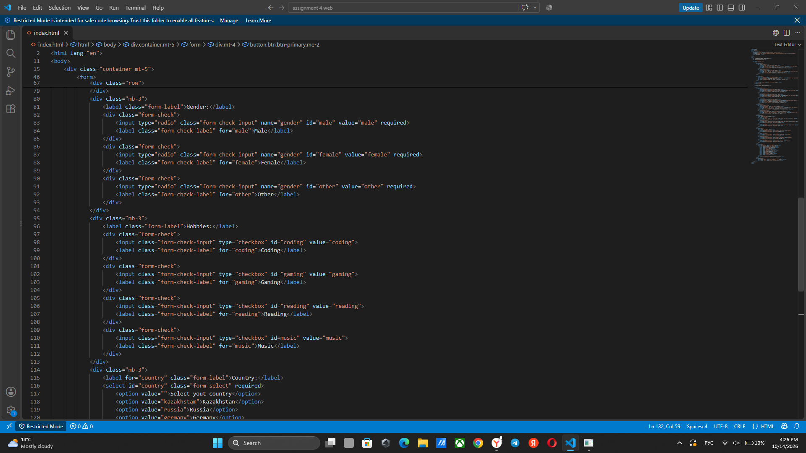
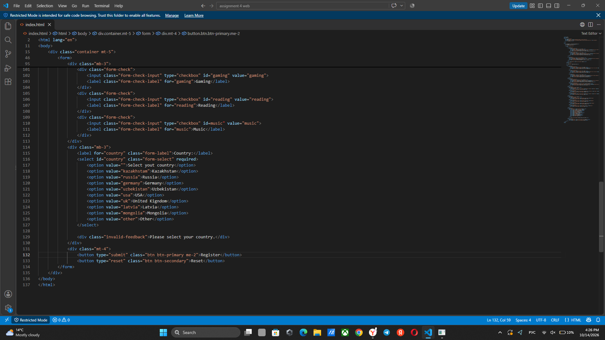
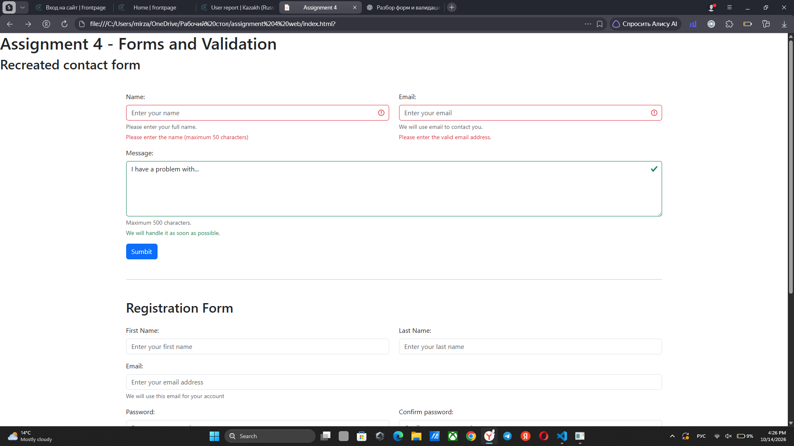
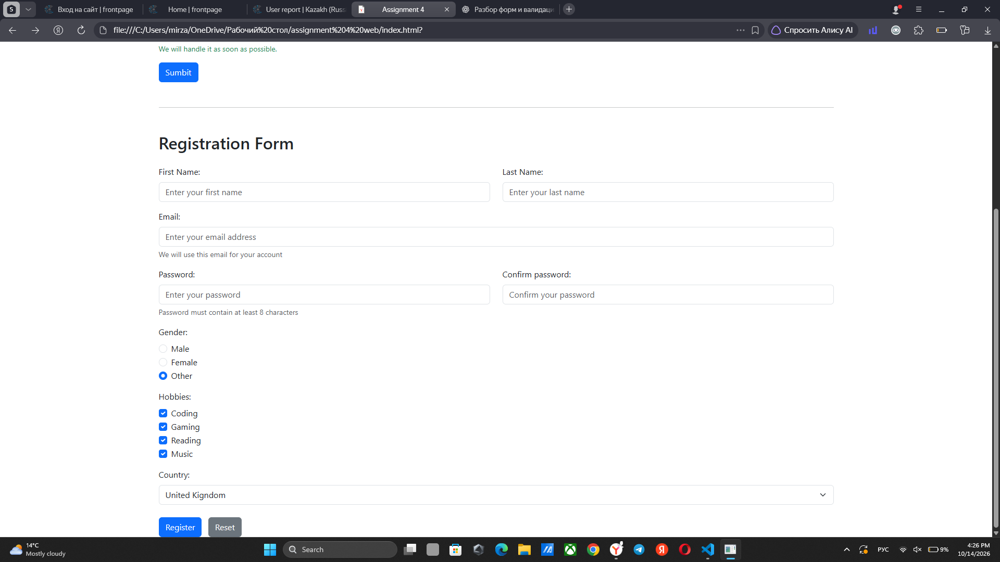

### Technologies

HTML5

Bootstrap 5.3.3

### Conclusion

In this assignment, I learned how to create forms, use HTML5 validation and style forms with Bootstrap. I also learned how to use Bootstrap validation classes and responsive grid layouts.